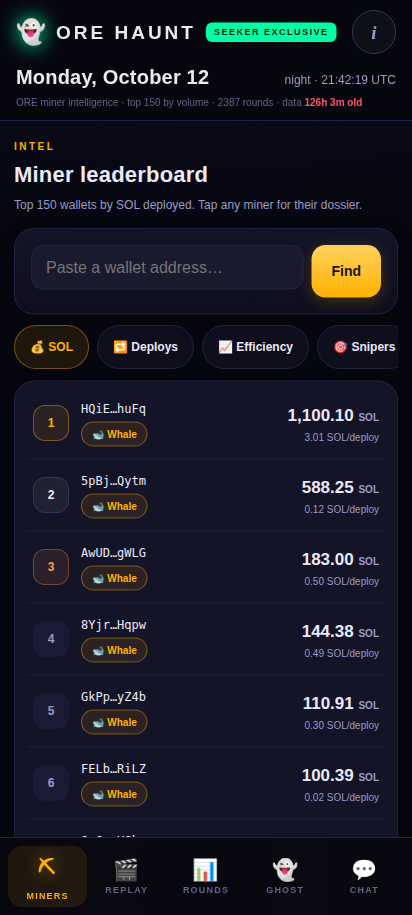
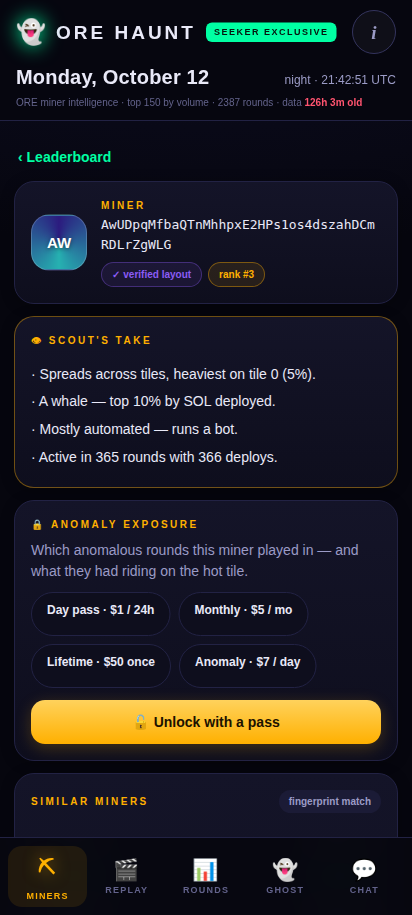
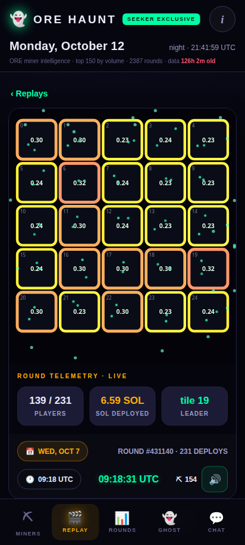
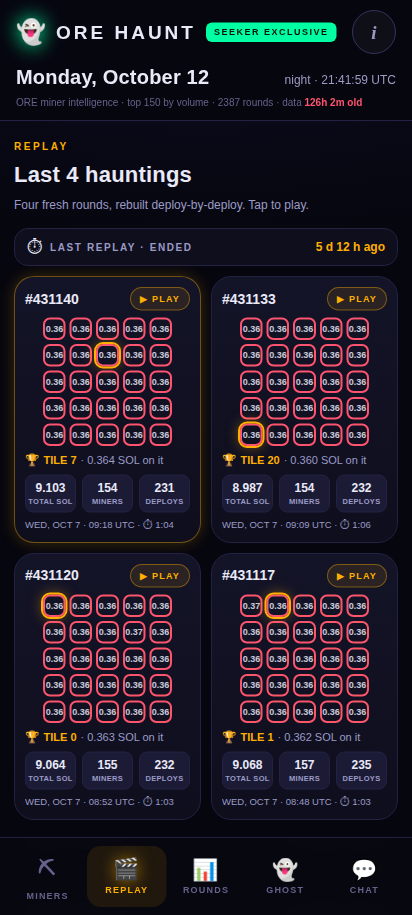

# ORE HAUNT

**Know the miners. Read the rounds.**

ORE HAUNT is the intel layer for ORE miners, built for the Solana Seeker. ORE rounds are public on-chain — every deploy, every winning tile, every wallet. HAUNT turns that raw record into something a miner can actually read: dossiers on the top 150 miners, an explorer over 200 recent rounds, cinematic replays of how rounds really played out, and an anomaly layer that flags unusual deploy behavior — 28 signals across the live window, describing deployments only, never the draw.

## Screenshots

| MINERS leaderboard | Miner dossier |
|---|---|
|  |  |

| Last 4 hauntings (REPLAY) | Replay mid-playback |
|---|---|
|  |  |

## Pitch deck & demo

- **Pitch deck:** [ORE_HAUNT_CLOCKIN_DECK.pdf](ORE_HAUNT_CLOCKIN_DECK.pdf) (11 slides, in this repo)
- **Demo video:** produced from the shipped build per [DEMO_SCRIPT.md](DEMO_SCRIPT.md) (filed with the CLOCK IN submission)

## What's inside

- **⛏ MINERS** — leaderboard of the top 150 miners by deploy volume. Every miner has a dossier: tile fingerprint heatmap, strategy classification (whale / sniper / spreader / balanced), session watchlist, head-to-head Miner Compare, and an anomaly-exposure card where the data supports one.
- **🎬 REPLAY** — 8 full round replays with real on-chain timestamps, rebuilt deploy-by-deploy. The replay page leads with the **Last 4 hauntings** — the four most recent replays on one page, each with its full record, under a live timer showing how long ago the last round ended.
- **📊 ROUNDS** — a 200-round explorer (search, sort, per-round tile boards), plus STATS, LAB, and ANOMALY views. ANOMALY is a capped premium tier: 100 slots, capped per rolling 24 hours.
- **👻 GHOST** — a mining-ghost companion hatched from your own miner profile (local prototype).
- **💬 CHAT** — a .skr-only community floor (local preview in this milestone build).

**Checkout** is built in: tier passes (Free / Day $1 / Monthly $5 / Lifetime $50, ANOMALY $7) payable in **SOL, ORE or SKR** — "pay with what you mine" — via Solana Pay links with on-chain verification against the treasury's token-balance delta.

## Run it

The app is a single self-contained HTML file. No build step, no server required:

```bash
# just open it
open app/haunt.html

# or serve it statically
cd app && python3 -m http.server 8000   # → http://localhost:8000/haunt.html
```

It is designed mobile-first for the Seeker's screen (verified at 360×740 and 412×915).

## Rebuild it

```bash
cd app
python3 build_app.py     # stdlib only; reads bundles/*.json, writes haunt.html
```

`build_app.py` assembles the app from the data bundles in `app/bundles/` (leaderboard, rounds, replays, metadata). The replay playback engine lives in `app/replay_engine.js` and is embedded unchanged. `app/PATCH_NOTES.md` is the running audit/fix record for the app — every UI change goes through designer → two auditors → checker, and the notes show that trail.

**Rebuild fidelity note:** the shipped `haunt.html` in this repo is the canonical build. `build_app.py` additionally derives the per-wallet tile fingerprints and anomaly-exposure data from deploy-event data collected by the pipeline in `data-pipeline/` (15,233 events across the 64 fully-scanned rounds in this build) that is **not** included in this repo — without it, a rebuild still succeeds and produces a fully working app, but without the fingerprint/exposure enrichment. The event data is pipeline output, regenerable by running `data-pipeline/`.

## Architecture

| Piece | What it is |
|---|---|
| `app/` | Single-file web app (source: `build_app.py` → `haunt.html`) + `replay_engine.js` timeline player |
| `backend/` | Optional companion backend (stdlib Python + SQLite, zero dependencies): server-side payment verification mirroring the client's semantics, an entitlement ledger, the rolling-24h ANOMALY slot ledger (cap 100), and Ed25519 challenge auth. 49 tests in `backend/test_all.py`. |
| `data-pipeline/` | The $0 data pipeline that feeds everything: reads settled Board/Round/Miner accounts straight from public Solana RPC (~2 calls per round — no transaction scanning for the core feed), websocket-triggered collection with snapshot capture of the full per-wallet census at each round flip, and a Tier-2 scanner for deep per-round deploy reconstruction. See `data-pipeline/OPTIMIZATIONS.md`. |

The client verifies payments on-device in this milestone configuration; when the backend is hosted and configured, verification upgrades to server-side with the slot ledger as the authority — the client patch for that is already shipped and inert until configured.

## Status — demo milestone (CLOCK IN)

Honest framing, because this project labels everything:

- The app is **built, audited, and verified locally**; dApp Store deployment is **postponed** — this is a demo milestone, not a store product.
- Checkout is **live-capable**: the treasury is set to the builder's own wallet (`raaru.skr`) and payments verify on-device. Entitlements in this milestone are browser-local.
- The dataset in this build is a snapshot collected live today from ORE V4 by the project's own pipeline — 222 rounds collected (the app surfaces the newest 200), 15,233 deploy events across 64 fully-scanned rounds. It is a build-time snapshot, not a real-time stream: the pipeline in `data-pipeline/` keeps collecting around the clock, and continuous in-app refresh is post-launch. (Separately, the anomaly detector and mining math were validated on a 2,433-round research corpus — that is the research's provenance, not this build's contents.)
- **Next:** host the backend (server-side verification + slot authority), device-verify the payment rail end-to-end on a Seeker, then dApp Store submission.

## Contact

Solo builder — raaru.skr · X / Twitter: [@raaruofficial](https://x.com/raaruofficial)

## License

MIT — see `LICENSE`.
